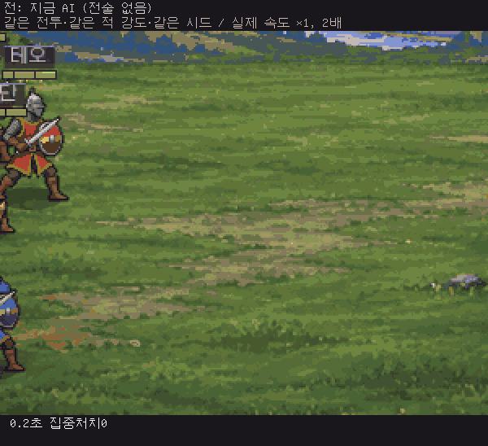
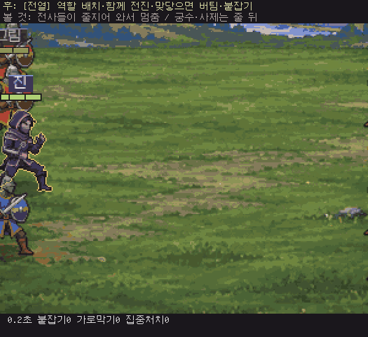
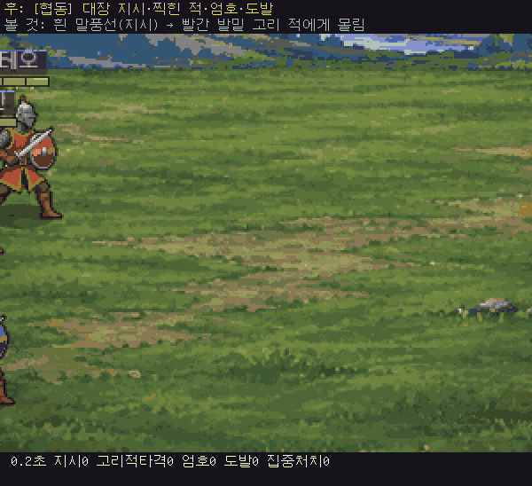
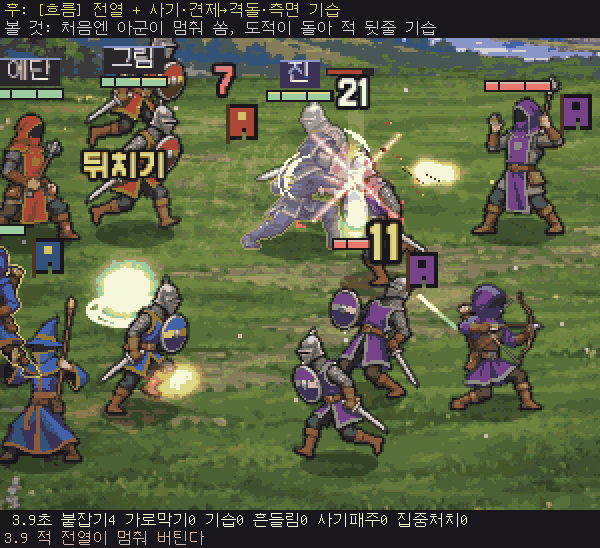
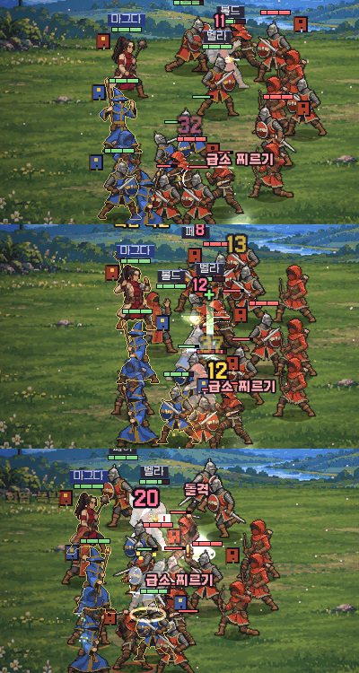

# 전투 전술: 무엇을 고를지 (2026-11-26)

플레이테스트 의견("유닛끼리 밀리는 게 어색하다", "연계 없이 마구 붙어서 단순한 공격과 수비만 주고받는다")과 두 답변을 바탕으로 정리했습니다. 두 답변은 다음과 같습니다.
- 전술이 유닛 효율의 30~50%를 좌우해야 한다.
- 진형은 고르는 것이 아니라 유닛 각자의 선호에서 저절로 잡혀야 한다.

아래 숫자는 같은 계약 수백 건을 시험판에서 직접 다시 돌려 확인한 값입니다. 게임 파일은 건드리지 않았습니다.

## 지금 무엇이 문제인가

- **한 덩어리로 뭉치고, 서로 밀어낸다.** 모두 가장 가까운 적에게 달려가서 3초쯤이면 한 덩어리가 됩니다. 제자리에 서 있는 유닛이 남에게 밀려나는 시간이 13%쯤 됩니다. 첫 충돌 때 맨 앞에 선 유닛이 전사 계열인 경우는 절반(52%)뿐입니다. 사제나 궁수가 적의 칼끝 안에 서 있는 시간이 27%이고, 첫 전사자 다섯 중 하나가 뒷줄입니다.
- **역할도 연계도 없다.** 적 하나에 붙는 근접 유닛은 79%가 딱 한 명이라서 전투가 1:1 맞교환으로 쪼개집니다. 가장 다친 적을 노리는 비율은 우연과 같습니다. 기술은 준비되면 그 자리에서 씁니다. 전사가 뒷줄을 지키지 않고, 도적이 뒤로 돌지 않으며, 사제는 오히려 적 쪽으로 걸어갑니다.
- **전술이 결과에 주는 영향이 0%다.** 계약 결과는 전투 전에 이미 주사위로 정해집니다. 전투 화면은 그 결과가 나오도록 적 강도를 맞춰서 재생할 뿐입니다. 그래서 유닛이 무엇을 하든 승패가 바뀌지 않습니다.

## 선택지

세 시험판 모두 같은 전투, 같은 적 강도로 비교했습니다. 각 GIF의 오른쪽 아래 글줄은 그 순간 일어난 연계를 세어 보여 줍니다.

### 가. 전열: 역할대로 서고, 함께 전진하고, 맞닿으면 버틴다

**어떻게 움직이나**
- 전사 계열은 앞줄에, 궁수는 그 뒤, 사제는 더 뒤, 도적은 양 끝에 섭니다.
- 앞줄은 발을 맞춰 전진하고, 적과 맞닿으면 멀리 쫓아가지 않고 버팁니다.
- 앞줄에 붙잡힌 적은 그 자리를 벗어나기 어렵습니다.
- 유닛마다 얼마나 쫓아갈지, 얼마나 뒤에 설지가 직업·대장·성격에 따라 다릅니다. 진형은 이 선호들에서 저절로 생깁니다.

**효과**
- 서 있다가 밀려나는 시간: 13% → 3%
- 뒷줄이 적 칼끝 안에 있는 시간: 27% → 9%
- 첫 전사자가 뒷줄인 경우: 20% → 1%
- 앞줄이 먼저 쓰러지고 뒷줄이 끝까지 버팁니다. 두 줄이 맞닿는 경계선이 보입니다.

**비용**
- 엔진 작업: 중간
- 새 그림: 필요 없음 (서기·공격·걷기 동작으로 충분하고, 그려 둔 달리기가 들어오면 더 좋아짐)
- 위험
  - 이것만으로는 용병단끼리의 차이가 커지지 않습니다. 사람 적 상대 시 구성에 따른 차이가 지금 16%에서 10%로 오히려 줄었습니다.
  - 짐승 상대로는 모든 용병단이 똑같이 30%쯤 강해집니다. 짐승에게는 뒷줄이 없기 때문입니다. 적 종류별 보정이 필요합니다.
  - 지는 전투가 길어집니다 (24초 → 32초).

### 나. 협동: 대장이 적을 찍고, 전사가 뒷줄을 엄호한다

**어떻게 움직이나**
- 대장이 3~4초마다 적 하나를 지목합니다 (흰 말풍선과 적 발밑의 붉은 고리).
- 대원들이 지목된 적에게 몰려가고, 그 적에게는 더 큰 피해를 줍니다.
- 전사는 뒷줄을 노리는 적을 가로막고 도발합니다.
- 사제는 가장 위급한 아군부터 치료합니다.

**효과**
- 한 전투에 지시 약 19번, 엄호 3번, 도발 3번이 나옵니다.
- 여럿이 함께 쓰러뜨리는 경우가 26% 늘어납니다.
- "연계"라는 말에 가장 직접 답하는 안입니다.

**비용**
- 엔진 작업: 중간
- 새 그림: 작은 표시들 (말풍선, 고리, 방패). 코드로 그릴 수 있습니다.
- 위험
  - 밀림이 그대로입니다 (14%). 뒷줄 노출도 거의 그대로입니다 (21%).
  - 효과의 대부분은 "지목된 적에게 +60%" 같은 규칙 덤에서 나옵니다. 적도 똑같이 쓰기 때문에 서로 상쇄되어 전체로는 0%입니다.
  - 짐승 상대로는 오히려 승률이 떨어집니다 (90% → 74%).
  - 말풍선과 방패는 작아서 놓치기 쉽습니다. 양쪽 지목 고리가 겹치면 화면이 어지럽습니다.

### 다. 흐름: 전열 위에 사기와 전투의 고비를 얹는다

**어떻게 움직이나**
- 궁수가 많은 쪽은 처음에 멈춰 서서 쏘고, 다른 쪽은 줄을 맞춰 다가옵니다. 그러다 "격돌!"
- 기술은 쓸모 있는 순간까지 기다렸다가 씁니다 (예: 여러 명이 다쳤을 때 광역 치유).
- 도적은 아군 앞줄이 붙잡아 준 뒤에야 적 뒷줄로 돌아 들어갑니다.
- 부대마다 사기가 있습니다. 대장이나 동료가 쓰러지면 흔들리고, 몰리면 결사항전하고, 무너지면 도망칩니다.
- 화면 위쪽에 "측면 기습!", "대열이 흔들린다" 같은 자막이 뜹니다.

**효과**
- 전투에 "견제 → 격돌 → 고비 → 붕괴"라는 이야기가 생깁니다. 자막이 가장 잘 읽힙니다.
- 살아서 물러나는 패배가 생겨서, "실패"와 "대참사"가 실제로 구분됩니다. 손실 절반 미만인 실패가 0%에서 17%가 됩니다.
- 같은 레벨에서 구성에 따른 차이가 가장 큽니다. 사람 상대 57%, 짐승 상대 2.5배(지나침).

**비용**
- 엔진 작업: 가장 큼
- 새 그림: 당장은 필요 없음. 나중에 "버티기·흔들림·후퇴" 동작이 있으면 자막 없이도 읽힙니다.
- 위험
  - 그 차이의 대부분이 벌칙입니다. 앞줄 없는 구성은 33% 약해지고, 잘 짠 구성은 0~7%만 강해집니다.
  - 도적의 우회는 드뭅니다 (세 전투에 한 번).
  - 지금 방식대로 결과에 맞춰 재생하면 재생 준비가 평균 0.08초에서 0.17초로, 최악 1.1초로 늘어납니다(세 안을 모두 켰을 때).

### 냉정하게 본 점

11 대 11 같은 큰 전투를 게임 크기 그대로 보면 세 안 모두 아직 한 덩어리로 보입니다. 위 사진은 위부터 지금, 전열, 전부입니다. 차이는 다음 세 가지로 드러납니다.
- 맞닿는 경계선 (전열)
- 누가 먼저 쓰러지는가 (앞줄이 먼저)
- 자막 (흐름)

모양만으로 "입체적"이 되지는 않습니다. 순서와 이유가 보여야 합니다.

## 추천

**"가(전열)"를 바탕으로 "다(흐름)"의 사기·격돌·기다리는 기술·자막을 얹고, "나(협동)"에서는 대장의 지목 고리와 전사의 엄호만 가져온다.**

가장 가까운 시험(세 안을 모두 켬)의 결과는 다음과 같습니다. 협동을 줄이면 화면은 덜 어지럽고 숫자는 비슷할 것으로 봅니다.
- 밀림: 13% → 4%
- 사람 상대 구성 차이: 16% → 49%. 엉뚱한 구성을 빼고 무난한 구성끼리만 비교해도 33%입니다.
- 짐승 상대 구성 차이: 84%. 너무 커서 짐승 무리용 행동(늑대는 옆구리, 트롤은 버팀)으로 낮춰야 합니다.
- 우리 쪽만 이 전술을 쓸 때의 효율: 1.26배

말씀하신 30~50% 범위에 들어옵니다.

**결과는 전투가 직접 정한다.**
- 주사위를 먼저 굴려 놓고 전투를 맞추는 지금 방식을 버립니다. 계약마다 전투를 한 번 계산하고, 그 승패와 쓰러진 사람을 그대로 결과로 씁니다.
- 적 강도는 적 종류별로 미리 맞춰 둡니다. 그러면 평범한 용병단은 예상대로 이기고, 잘 짠 용병단은 예상보다 잘, 엉뚱한 용병단은 예상보다 못 싸웁니다.
- 비용: 계약 하나에 약 0.1초. 전투를 안 보는 계약도 마찬가지입니다.
- 규칙을 바꿀 때마다 이 보정을 다시 맞춰야 합니다. 도구로 만들어 둡니다.

**출전 전 예상은 지금 계산을 그대로 "전술을 뺀 중간값"으로 둔다.**
- 계산 비용이 없으므로 대충의 난이도 표시로 바꿀 이유가 없습니다.
- 다만 실제 결과가 전술에 따라 오르내리므로 정확한 %는 오해를 부릅니다. "압도 / 우세 / 백중 / 열세 / 무모" 다섯 단어로 보여 줍니다.
- 전투 뒤 보고에는 "예상보다 잘 싸웠다 / 못 싸웠다"를 한 줄 붙여, 전술이 결과를 바꿨다는 것을 플레이어가 알게 합니다.

**순서**
1. 전열과 밀림 해결. 혼자서도 화면이 나아지고 위험이 적습니다.
2. 사기·격돌·자막·지목·엄호
3. 결과를 전투가 정하도록 전환

## 주인님만 답할 수 있는 질문

1. **전술이 주로 "벌"이어도 괜찮을까요?** 지금 측정으로는 무난한 구성이 예상보다 0~10% 잘하고, 엉뚱한 구성(앞줄 없음, 전원 마법사 등)은 30~40% 못합니다. 이대로 둘까요? 아니면 잘 맞는 조합(예: 궁수 대장 + 궁수 많은 부대, 사제 + 그를 지키는 전사)에 분명한 보상을 더 얹어 위쪽으로도 크게 벌어지게 할까요?
2. **출전 화면에서 명백한 약점을 미리 알려 줄까요?** 예를 들어 "앞줄이 없다", "치유사를 지킬 전사가 없다" 같은 짧은 경고입니다. 고르는 장치는 아니지만 힌트가 됩니다. 아니면 플레이어가 전투와 전투 후 보고에서 스스로 깨닫게 할까요?
3. **전투의 고비를 글자로 보여 줘도 될까요?** 화면 위의 "측면 기습!", "대열이 흔들린다" 같은 자막입니다. 아니면 동작으로만 보여야 할까요? 동작으로만 보이려면 "버티기·흔들림·후퇴" 그림을 새로 그려야 합니다.
